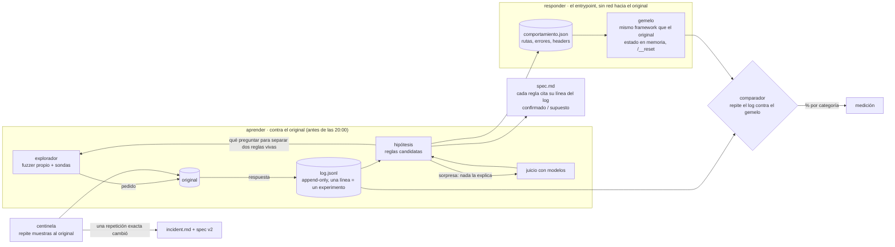

# DISENO.md · el gemelo: clonar un servicio que nadie entiende

> systems design (30 %), cierre 12:00 bog. **borrador antes del material**: lo que diga el readme del material sobre formatos manda. las afirmaciones sobre el servicio son **supuestos** hasta que una línea del log las pruebe.

**reto 2, la caja negra** · romina pitronello con claude (lidera), fable y sol · pasaelfiltro · 10 oct 2026

## 1 · problema, en una frase
reemplazar un servicio http **con estado** por uno nuestro que responda **byte por byte igual** (código, headers, cuerpo, también errores, rutas que no existen y llamadas sin token), sin llamarlo nunca, y seguir igual cuando el original cambie a las 15:30.

## 2 · supuestos (cada uno dice qué se rompe si es falso)
| # | supuesto | si es falso |
|---|---|---|
| S1 | dado el estado y el pedido, el original es determinista salvo campos volátiles (fecha, ids, tiempos) | el comparador tiene que aprender qué campos son volátiles en vez de exigir igualdad; lo detecta repitiendo el mismo pedido dos veces |
| S2 | el original corre sobre un framework común, y sus respuestas por defecto (404, 405, json mal formado, etag) delatan cuál | hay que copiar a mano cada respuesta por defecto; más lento, no imposible |
| S3 | un test = `/__reset` + una secuencia corta de pedidos | si el estado cruza tests, el clon tiene que modelar más estado del que planeamos |
| S4 | podemos resetear el original para explorar | sin reset, cada experimento ensucia el siguiente; se exploraría con secuencias que se deshacen solas |

## 3 · casos difíciles y lo que dejamos fuera
- **difíciles:** mensajes de error del parser (delatan el lenguaje), orden y mayúsculas de headers, `Content-Length` y `ETag` calculados, `HEAD`/`OPTIONS`/`405` con `Allow`, barras finales, mayúsculas en rutas, `/__reset` sin token (no debe delatarse), estado que depende del orden.
- **fuera, con razón:** igualar latencias (no es comportamiento observable de un test), valores exactos de `Date` (no se puede, se iguala el formato), comportamiento bajo carga.

## 4 · arquitectura

## 5 · decisiones y lo que descartamos
| # | decisión | descartada | por qué | costo aceptado |
|---|---|---|---|---|
| D1 | **el log es la fuente de verdad**: el set propio, la evidencia de la spec y el centinela salen del mismo `log.jsonl` | baterías de pruebas separadas | un solo instrumento: no sobre-testeamos y cada número de la spec se puede rastrear a una línea | el log crece; se filtra por categoría |
| D2 | **construir el gemelo sobre el mismo framework** que delata el original (huella en sus errores por defecto) | un servidor genérico que imite cada default a mano | los defaults (404, 405, json inválido, etag) salen iguales por construcción; lo nuestro es solo la lógica | si nos equivocamos de framework, se nota en el comparador en la primera hora |
| D3 | **lo tabular como dato** (rutas, códigos, plantillas de error, headers) en `comportamiento.json`; **la lógica con estado, en código** | todo en código / todo en datos | el incidente probablemente cambia algo tabular: se cambia un dato, no se reescribe; la lógica con estado no cabe bien en una tabla | dos lugares que mirar |
| D4 | **una sola instancia, estado en memoria**, desplegada en un contenedor | serverless (workers, edge functions) | `/__reset` y el estado necesitan una sola memoria; los gateways serverless agregan o reescriben headers, y aquí los headers se evalúan | un proceso que no puede caerse entre 20:00 y 22:15: lo vigila el health |
| D5 | **el explorador elige la consulta que separa dos reglas vivas** (método del ensayo) y los modelos solo leen sorpresas | un fuzzer aleatorio puro / un agente llm que explore todo | menos pedidos por regla confirmada; el llm aparece donde las reglas no explican | hay que escribir las hipótesis; el fuzzer aleatorio queda para barrer rutas y bordes |
| D6 | **la spec la prueba otra pluma**: fable escribe un segundo gemelo **solo con la spec**, sin ver nuestro código, y lo medimos con el mismo comparador | revisar la spec leyéndola | la rúbrica pide que otro ingeniero la pueda reimplementar: eso se mide, no se opina | una ventana de fable por la tarde |

## 6 · plan para medir (antes de construir)
- **métrica:** % de experimentos del log donde el gemelo responde igual que el original (código + headers no volátiles + cuerpo), **por categoría**: rutas que existen · errores de entrada · auth y token · rutas inexistentes · secuencias con estado.
- **para no medirnos con nuestras propias preguntas:** se separa un **conjunto retenido** que el explorador no eligió: los ejemplos del material, venenos escritos a mano por fable y secuencias de sol. el gemelo nunca se ajusta mirando el retenido.
- **umbral:** ≥ 75 % en el retenido (el 4 de la rúbrica es «más de 75 %»); bajo 50 % en una categoría → esa categoría es la próxima hora de trabajo.
- **cómo se corre:** `python3 medir.py --log log.jsonl --gemelo URL` (null hasta escribirlo; es lo primero después del explorador).

## 7 · escalar y cambiar
- **por pedido:** el gemelo no llama a nadie: costo 0, latencia de un diccionario. el set oculto puede tener 100 o 10.000 tests.
- **por regla aprendida:** pedidos al original y tokens crecen con las **sorpresas**, no con las rutas.
- **a otro servicio:** explorador, comparador, centinela y formato de spec no saben de este servicio; lo específico es `comportamiento.json` y la lógica con estado.
- **el incidente (15:30):** desde las 15:00 el centinela repite cada pocos minutos ~30 experimentos canónicos contra el original. **solo una repetición exacta que cambia acredita un cambio.** entonces: se congela spec v1 (tag), se explora la diferencia, spec v2 marca **antes / después** con sus líneas del log, y el gemelo se actualiza cambiando datos donde se pueda. todo queda en `incident.md`.
- **dónde se rompe:** un original no determinista que no sepamos normalizar (S1); estado oculto que cruza tests (S3); un framework exótico (S2).

## 8 · cómo trabajamos
una persona y tres modelos que firman lo que escriben (`AGENTS.md`). claude lidera e integra; fable objeta y reimplementa desde la spec; sol construye en paralelo desde otra casa de modelos. todo lo que el jurado lee sale del log, y todo lo que no salió también se escribe.
