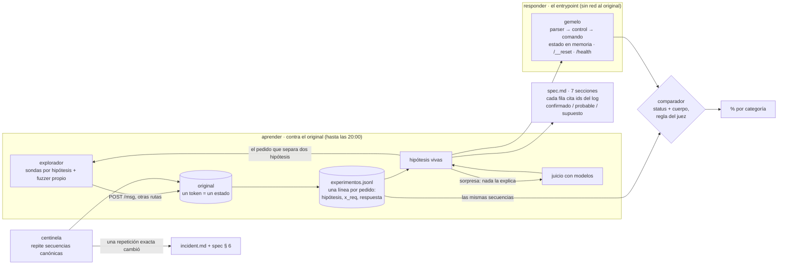

# DISENO.md · el gemelo: clonar un servicio que nadie entiende

> systems design (30 %), cierre 12:00 bog. fuentes: `BRIEF.md` y `material/README.md`. lo que todavía no probamos contra el original está marcado **supuesto**.

**reto 2, la caja negra** · romina pitronello con claude (lidera), fable y sol · pasaelfiltro · 10 oct 2026

## 1 · problema
un servicio bancario de mensajes de texto (`POST /msg`, cuerpo `{"m": "CMD;arg;…;control"}`) con **estado**: crea cuentas, mueve plata, anula operaciones. hay que reemplazarlo por uno nuestro que dé **el mismo status y el mismo cuerpo** en cada paso (json comparado sin orden de claves; texto no-json, carácter por carácter), sin llamarlo nunca, y que siga igual cuando el original cambie a las 15:30. **los headers no se comparan.** se evalúa con 100 tests desde un `/__reset`: 40 de un pedido, 45 de 2–5, 15 de 6–12; ninguno repite los 20 ejemplos. y entregamos una spec que otro ingeniero pueda reimplementar, con cada comportamiento citando una línea del log.

## 2 · supuestos y límites
| # | supuesto | de dónde | si es falso |
|---|---|---|---|
| S1 | determinista dado el estado (ids secuenciales `AC-0001`, `OP-0001`) | ejemplos 3, 4, 6, 7 | habría que modelar azar o tiempo; lo vemos repitiendo una secuencia tras dos resets |
| S2 | el dígito de control es una función del mensaje, calculable | ejemplos 2 vs 3 (`83` inválido, `82` válido) | **no calza ninguna fórmula simple** (suma, crc, adler, módulos 2–999, probamos 10:1x); si no la encontramos, el gemelo acepta lo visto y rechaza lo demás, y eso cae en los tests con mensajes nuevos |
| S3 | el estado vive por token y `/__reset` lo vuelve a cero | material | — (lo dice el material) |
| S4 | lo que el set prueba fuera de `/msg` (rutas, métodos, sin token) responde igual siempre | contrato | se descubre en la primera hora, barato |
| **límites** | 10 pedidos/s y **8.000 por día por token**; tokens a las 20:00 dejan de servir; 5 s por paso | material | el presupuesto de pedidos manda sobre el fuzzer |

## 3 · casos difíciles y lo que dejamos fuera
- **difíciles:** el algoritmo del control (S2); **el orden en que se evalúan los errores** (¿aridad antes que control? ejemplo 20); mayúsculas (ejemplo 11 `CONSULTa` funciona); límites (100.000 pasa, 120.000 no: ¿dónde está el corte, y es por operación o por día?); anular un depósito o una transferencia que deja saldo negativo; las rarezas que hay que copiar tal cual (`"recieved"`, `"comando desconocido "` con espacio, `cuentaId` / `cuenta_id`).
- **fuera, con razón:** headers (no se comparan); latencia (basta con < 5 s); un llm dentro del gemelo (está permitido, pero un servicio determinista se clona con código determinista: más rápido, gratis y explicable).

## 4 · arquitectura

## 5 · decisiones y lo que descartamos
| # | decisión | descartada | por qué | costo aceptado |
|---|---|---|---|---|
| D1 | **el log es la fuente de verdad**: set propio, evidencia de la spec y centinela salen de `experimentos.jsonl` | baterías de pruebas aparte | un instrumento; no sobre-testeamos; cada afirmación se rastrea a un id | el log crece; se filtra por `seq` |
| D2 | **el comparador usa la regla exacta del juez** (status + json sin orden de claves; texto exacto si no es json) | comparar todo, headers incluidos | medimos lo que se evalúa, nada más | no vemos headers; no importan |
| D3 | **gemelo en capas que siguen el orden de los errores**: ruta → auth → cuerpo → sintaxis → control → comando → reglas | un `if` gigante por comando | el orden de evaluación es justo lo que el set prueba con mensajes malos; cada capa es una sección de la spec | hay que descubrir el orden con pedidos que rompen dos cosas a la vez |
| D4 | **lo tabular como dato** (comandos, aridad, códigos y textos de error, límites) y **la lógica con estado en código** | todo en código | si el incidente cambia un texto, un límite o un código, se cambia un dato | dos lugares que mirar |
| D5 | **un solo proceso, un estado en memoria**; con otro token o sin token responde lo que responde el original | serverless | el set le habla a un solo proceso y varias instancias tendrían estados distintos (material) | un proceso que no puede caerse 20:00–22:15 |
| D6 | **sin llm en el gemelo**; los modelos ayudan a explorar (proponer hipótesis ante sorpresas, como el algoritmo del control) | un llm que responda lo que el código no sabe | determinista, 0 us$, < 5 s, explicable; lo desconocido se responde con un **supuesto escrito** en la spec | lo no explorado falla igual en todos lados |
| D7 | **exploración por hipótesis, no fuzzing ciego**: cada pedido dice qué hipótesis separa (el log lo exige) | fuzzer aleatorio masivo | 8.000 pedidos por token y día: alcanzan para pensar, no para barrer; el fuzzer queda para bordes (largos, caracteres, números) | escribir hipótesis cuesta tiempo |
| D8 | **la spec la prueba otra pluma**: fable escribe un segundo gemelo solo con la spec y lo medimos con el mismo comparador | releer la spec | la rúbrica pide que otro ingeniero la reimplemente: se mide | una ventana de fable por la tarde |

## 6 · plan para medir (antes de construir)
- **métrica:** % de **tests** que pasan (todas las respuestas de la secuencia iguales), con la forma del set: 40 % de un pedido, 45 % de 2–5, 15 % de 6–12. por categoría: entrada · integridad · cada comando · memoria · errores.
- **retenido:** los 20 ejemplos oficiales + secuencias que el explorador no eligió (venenos a mano de fable, secuencias de sol). el gemelo nunca se ajusta mirando el retenido.
- **umbral:** > 75 % en el retenido = territorio de 4. una categoría bajo 50 % es la próxima hora de trabajo.
- **primer hito medible:** el gemelo reproduce los 20 ejemplos (hoy 0/20).
- **cómo se corre:** `python3 medir.py --log experimentos.jsonl --gemelo URL`.

## 7 · escalar y cambiar
- **por test:** el gemelo no llama a nadie: costo 0 y microsegundos. 100 o 10.000 tests, igual.
- **por regla aprendida:** pedidos al original crecen con las hipótesis vivas, no con los comandos. el equipo puede abrir más tokens en paralelo (estados separados).
- **el incidente (15:30):** desde las 15:00 el centinela repite cada pocos minutos 3–4 secuencias canónicas que tocan cada comando y cada error. **solo una repetición exacta que cambia acredita un cambio.** entonces: tag de la spec v1, explorar la diferencia, el gemelo pasa a la versión nueva (el set evalúa la de las 20:00), spec § 6 dice qué cambió, desde cuándo y con qué ids. en `incident.md`.
- **dónde se rompe:** un control que no encontramos (S2) o un cambio a las 19:50 que el centinela ve tarde.

## 8 · cómo trabajamos
una persona y varios modelos que firman lo que escriben (`AGENTS.md`). claude lidera e integra; fable objeta y reimplementa desde la spec; sol construye en paralelo desde otra casa de modelos. el log manda: lo que no tiene línea, no se afirma.
