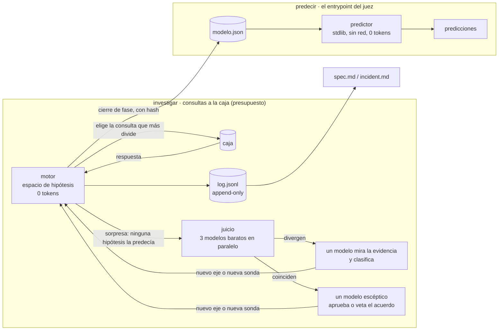

# DISENO.md · [nombre del sistema]

> entrega de **systems design** (30 %), cierre **12:00 bog**. criterios: entendimiento del problema · arquitectura y trade-offs · plan para medir. lo que miran a priori: cuánto se piensa en sistemas, cómo escala y qué cuesta cada decisión.
>
> **estado: borrador antes del brief.** lo marcado **[pre-brief]** es lo que traemos del ensayo del viernes, con evidencia; es hipótesis de diseño hasta que el brief la confirme o la tumbe. lo marcado `null` lo dice el brief.

**reto:** 2 — la caja negra · **equipo:** romina pitronello con claude y sol (pasaelfiltro) · **fecha:** sábado 10 oct 2026

## 1. problema

null: en nuestras palabras, no las del brief.

**[pre-brief]** lo que creemos que está en juego: una caja que decide sobre personas (en pasaelfiltro, un ats que filtra currículums) y que nadie explica. el sistema tiene que aprender qué hace la caja **preguntándole poco**, predecir lo que hará con casos que no vio y **notar cuando cambia**. para las personas, el valor no está en el puntaje: está en poder decirle a alguien «escribiste tu experiencia como rango de fechas, y esta caja no lo lee».

## 2. supuestos

| # | supuesto | si es falso, qué se rompe |
|---|---|---|
| S1 | **[pre-brief]** la caja es determinista dentro de una fase | el motor elimina hipótesis por una respuesta; con ruido inventaría mecanismos. mitigado: repite cada sorpresa antes de creerle (en el ensayo, con 10 % de ruido, lo notó en 18 de 20 corridas) |
| S2 | **[pre-brief]** la caja la escribió alguien en una tarde: reglas literales, regex de manual | si es un modelo estadístico, el espacio de hipótesis no la contiene; se ve porque las sorpresas no paran |
| S3 | null (contrato del entrypoint) | |

## 3. casos difíciles

- **[pre-brief]** lo que el espacio de hipótesis no imagina. en el ensayo, **todas** las fallas fueron mecanismos que no estaban en el espacio (`\s+` entre «power» y «bi», «1,5 años» leído como 5, límite de palabra en «TableauServer»), y **todas con confianza 1,0**.
- **[pre-brief]** el acuerdo: cuando todas las hipótesis vivas coinciden, el sistema deja de preguntar justo donde se equivoca.
- el cambio de la tarde (§ 9).

## 4. fuera de alcance (y por qué)

- null

## 5. arquitectura

**[pre-brief]** dos planos separados: **investigar** (caro, pocas veces, con modelos) y **predecir** (barato, muchas veces, sin modelos).

| componente | responsabilidad | entra | sale |
|---|---|---|---|
| motor | mantener las hipótesis vivas, elegir la consulta que más las divide, presupuesto, fases | consultas candidatas, respuestas | log, modelo |
| juicio | solo ante una sorpresa: proponer el mecanismo que falta y la consulta que lo separa | la sorpresa y lo observado | un eje nuevo o una sonda |
| centinela | repetir consultas ya hechas para notar un cambio | log de la fase anterior | alerta de cambio con evidencia |
| predictor | votar con las cajas vivas; abstenerse donde difieren | modelo.json, casos | predicciones con confianza |

## 6. decisiones y alternativas descartadas

| # | decisión | alternativa descartada | por qué esta | costo que aceptamos |
|---|---|---|---|---|
| D1 | **[pre-brief]** el predictor no llama modelos | un llm que lee cada caso y predice | costo 0 por caso, determinista, corre en cualquier máquina sin llave: escala a cualquier n del set oculto | no generaliza a lo que el modelo no capturó; lo mitigamos investigando mejor, no prediciendo más caro |
| D2 | **[pre-brief]** lo aprendido es un **modelo como dato** (json), no reglas en el código | escribir a mano las reglas que vimos | cuando la caja cambie, se vuelve a investigar y se exporta otro modelo; el código no se toca. es lo que impide sobreajustar | hay que declarar el espacio de hipótesis (media hora por dominio) |
| D3 | **[pre-brief]** los modelos solo en las sorpresas (en el ensayo, 4 de 55 consultas) | un agente llm que conduce toda la investigación | el motor elige mejor y sin tokens lo procedimental; el modelo aparece donde el motor quedó ciego | si una sorpresa no se nota (la caja coincide por azar), el juicio no se llama |
| D4 | **[pre-brief]** el modelo escéptico va en la puerta del **acuerdo**, no del desacuerdo | escalar solo cuando los modelos discrepan | en el ensayo los errores salieron del acuerdo, con confianza 1,0: coincidir no es observar | una llamada más por acuerdo en sorpresas |
| D5 | **[pre-brief]** proveedor intercambiable: pi + openrouter por defecto, pero el juicio acepta cualquier backend (también la cli de claude) | atarse a pi | no estamos obligados a usar pi; y el predictor (D1) no necesita ninguno | probar cada backend una vez |
| D6 | null | | | |

## 7. plan para medir (antes de construir)

- **métrica principal:** null (la del brief). **secundarias:** acierto por categoría, consultas gastadas, **costo por caso medido**, latencia.
- **[pre-brief] set propio** en `evals/`: fáciles · difíciles · borde · **nuevos** (formas que no aparecen en los ejemplos del brief) · **venenos a mano** de una pluma que no vio el código (en el ensayo encontraron el error grande).
- **[pre-brief] cajas simuladas** con mecanismos conocidos, incluidas una con ruido y una que cambia a mitad: medimos si el sistema recupera el mecanismo, no solo si acierta.
- **cómo se corre:** null · **umbral para decir «funciona»:** null.

## 8. escalabilidad

**[pre-brief]**
- **casos a predecir:** costo marginal 0 y tiempo lineal (D1). el set oculto puede tener 50 o 50.000 casos; la reserva de us$ 5 no se toca.
- **consultas a la caja:** el motor no recorre el espacio, lo parte leyendo qué ejes toca cada hipótesis; en el ensayo, de 90 millones de cajas posibles a 6 en 54 consultas.
- **tokens:** crecen con las **sorpresas**, no con las consultas ni con los casos.
- **dominios nuevos:** un dominio es una carpeta (`ETIQUETAS`, `EJES`, `responder`); el motor no sabe de qué trata la caja. probado con dos dominios (ats y créditos).
- **dónde se rompe:** si la caja no es de reglas (S2) el espacio no la contiene; si el espacio crece mucho, el costo de partirlo crece con el número de ejes que lee cada consulta.

## 9. absorber el cambio (incidente, 15:00–16:00 bog)

**[pre-brief]** no sabemos qué cambia. lo que sí está decidido:
- **detectar:** el centinela repite consultas ya hechas; solo una **repetición exacta** que cambia acredita un cambio (una respuesta nueva puede ser algo que no habíamos preguntado). también vigila señales del entorno (un contador que vuelve a empezar, un error de forma) y se detiene en vez de seguir.
- **adaptarse:** se congela el modelo de antes (con hash), se vuelve a investigar desde el espacio con las observaciones que siguen válidas, y se exporta un modelo nuevo. no se edita código para acomodar el cambio.
- **explicar:** `incident.md` sale del log: qué consulta, a qué hora, qué cambió, qué quedó sin separar.
- **[pre-brief] evidencia:** en el ensayo detectamos el cambio en 13 consultas y el juez nos dio 3/4 en incidente. lo que no salió: la consulta que separaba las dos hipótesis vivas no se alcanzó a hacer.

## 10. presupuesto

disponible us$ 45 · reserva us$ 5 para el set oculto. costo por caso: **[pre-brief] 0 en predicción (D1)**; investigación: null (se mide en la primera corrida).

## 11. riesgos

| riesgo | probabilidad | mitigación |
|---|---|---|
| el brief no deja traer código escrito antes | null | se trae el método (este documento) y se reescribe; el motor es stdlib y chico |
| el entrypoint exige un llm por caso | null | D1 cae; el juicio se vuelve predictor con el modelo más barato que pase el set propio, y se mide costo por caso contra la reserva |
| el sistema acierta con confianza donde no observó | alta (ya pasó) | D4, venenos a mano, `spec.md` dice qué no significa la confianza |

## 12. cómo trabajamos

este sistema lo diseñaron y construyeron una persona y varios modelos que firman lo que escriben. el método está en `AGENTS.md`; cómo se ve en la práctica, en el `README`.
