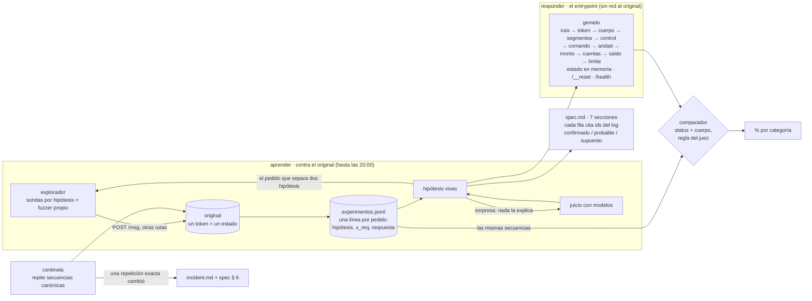

# DISENO.md · el gemelo: clonar un servicio que nadie entiende

> systems design (30 %), cierre 12:00 bog. fuentes: `BRIEF.md`, `material/README.md` y **288 pedidos útiles al original** (`experimentos.jsonl`; los números entre paréntesis son sus ids). el log tiene 686: los otros 398 son un bucle nuestro (límites, § 2). lo que todavía no probamos contra el original está marcado **supuesto**.

**reto 2, la caja negra** · romina pitronello con claude (lidera), fable y sol · pasaelfiltro · 10 oct 2026

## 1 · problema
un servicio bancario de mensajes de texto (`POST /msg`, cuerpo `{"m": "CMD;arg;…;control"}`) con **estado**: crea cuentas, mueve plata, anula operaciones. hay que reemplazarlo por uno nuestro que dé **el mismo status y el mismo cuerpo** en cada paso (json comparado sin orden de claves; texto no-json, carácter por carácter), sin llamarlo nunca, y que siga igual cuando el original cambie a las 15:30. **los headers no se comparan.** se evalúa con 100 tests desde un `/__reset`: 40 de un pedido, 45 de 2–5, 15 de 6–12; ninguno repite los 20 ejemplos. y entregamos una spec que otro ingeniero pueda reimplementar, con cada comportamiento citando una línea del log.

lo que ya sabemos de la forma: el mensaje son segmentos separados por `;` y el último es un dígito de control (el verificador del iban, S2). hay **siete comandos**: los seis de los ejemplos (`PING`, `ALTA`, `CONSULTA`, `DEPOSITO`, `TRANSFER`, `ANULA`) y **`HALT`, oculto y destructivo** (S5), que apareció porque el error de comando desconocido sugiere el comando más parecido (127–128).

## 2 · supuestos y límites
| # | supuesto | de dónde | si es falso |
|---|---|---|---|
| S1 | determinista dado el estado (ids secuenciales `AC-0001`, `OP-0001`) | **confirmado**: tras un reset, los 20 ejemplos dan respuestas idénticas (2–21); los ids vuelven a `0001` en cada secuencia (23, 82, 97, 135) y un pedido fallido no consume id (222–223) | habría que modelar azar o tiempo |
| S2 | el dígito de control es **ISO 7064 MOD 97-10, el del iban**: N = el mensaje sin su último segmento leído como número (dígitos tal cual, letras A=1…Z=26 sin importar mayúsculas, lo demás no cuenta) y control = 98 − (100·N mod 97), de 2 a 98, comparado **como texto** (`2` vale, `02` no) | **confirmado**: salió fuera de línea de los 16 ejemplos con control válido, sin gastar pedidos (las tres `CONSULTA` fijan el módulo 97); lo confirmaron 24–30 y 44–47. las fórmulas de bytes (suma, crc, adler) no calzaban porque el servicio lee el mensaje como número. `herramientas/control.py` | el gemelo rechazaría mensajes válidos y caería todo test con mensajes nuevos; por eso el centinela lo vigila (§ 7) |
| S3 | el estado vive por token y `/__reset` lo vuelve a cero | material; **confirmado** (143: tras el reset, `AC-0001` ya no existe). el contador del header `X-Req` no se reinicia (62), pero los headers no se comparan | — |
| S4 | lo que el set prueba fuera de `/msg` responde igual siempre | **confirmado**: toda ruta o método distinto de `POST /msg`, `GET /health` y `POST /__reset` da 404 `E404 ruta desconocida`, **incluso sin token** (52–61); la query string se ignora (62); sin token, con otro token o con `Bearer` mal escrito, 401 `E001 no autorizado` (50–51, 63–67) | — |
| S5 | **no ejecutamos `HALT` con confirmación**: sin argumentos da `E302` (137) y con uno, 409 `E520 operación destructiva: detiene el servicio; reenvía con confirmación` (145). no sabemos qué hace confirmado | decisión pendiente de romina: el original lo comparten todos los equipos y el mensaje dice que lo detiene | si el set prueba `HALT` confirmado, el gemelo responde lo que suponemos, escrito como **supuesto** en la spec |
| **límites** | 10 pedidos/s y **8.000 por día por token**; tokens a las 20:00 dejan de servir; 5 s por paso. un cuerpo grande da 413 `E101 cuerpo demasiado grande`: 8.191 bytes pasan, 8.194 no (277–288; probable: el tope es 8 KiB) | material | el presupuesto de pedidos manda sobre el fuzzer. **llevamos 686 de 8.000**: 398 son un error nuestro, una búsqueda binaria que repitió el mismo pedido en bucle (289–686). ahora `herramientas/lote.py` se detiene si un pedido se repite más de 5 veces seguidas |

## 3 · casos difíciles y lo que dejamos fuera
- **difíciles, ya resueltos con el log:**
  - el algoritmo del control (S2).
  - **el orden en que se evalúan los errores** (D3): el control va antes que el comando y la aridad (42–43, 213–214). `PING` es la excepción: no valida el control (39–40).
  - mayúsculas: el comando no las distingue (12, 133, 244); los ids de cuenta y de operación sí (38, 115).
  - el límite es **> 100.000 por operación y no acumulado** (105–108), **y no aplica entre cuentas con el mismo nombre de titular** (813–815). solo lo tienen las transferencias: un depósito de 9.999.999.999 pasa (270).
  - **bloqueo**: tres transferencias seguidas de una cuenta rechazadas por límite o saldo la bloquean para transferir (`E510`, 409); un depósito a la cuenta la desbloquea (824–827, 885–886). lo encontró el centinela en su primera vuelta (737).
  - montos: entero de 1 a 10 cifras, sin cero a la izquierda ni signo. si no, `E303 monto inválido` (91–96, 233–235, 271–272).
  - **los saldos pueden quedar negativos**: anular un depósito ya gastado (116–117) o una transferencia cuyo destino ya gastó la plata (228–230) deja la cuenta bajo cero. con saldo negativo no se puede transferir (231).
  - el mensaje no se recorta: un espacio delante cambia el comando, un espacio o salto al final rompe el control (252–254).
- **errores nuevos que no estaban en los ejemplos:** `E100 json inválido`, `E101 cuerpo demasiado grande` (413), `E102 falta m`, `E103 falta control`, `E104 segmento vacío`, `E303 monto inválido`, `E304 origen y destino iguales`, `E402 operación inexistente`, `E404 ruta desconocida`, `E001 no autorizado` (401) y `E510 cuenta bloqueada` (409), `E520` (409, `HALT`) y `E599 service halted` (503).
- **siguen difíciles:**
  - `HALT` (S5).
  - la **sugerencia** del comando desconocido: aparece solo si hay un comando a distancia de edición ≤ 2, sin importar mayúsculas, y en un empate gana el primero en orden alfabético (147–160, 208–209, 256). hay que copiarla exacta, porque es parte del cuerpo.
  - el lugar de `E101` en la cadena de errores, y si el corte es exactamente 8.192 bytes.
  - lo que cambie a las 15:30.
- **rarezas que hay que copiar tal cual:** `"recieved"`, `"comando desconocido "` con espacio final, `cuentaId` en el alta y `cuenta_id` en la consulta, `ANULA` repetido responde **200** con `{"ok": false, "motivo": "ya anulada"}` (15, 232).
- **fuera, con razón:** headers (no se comparan); latencia (basta con < 5 s); un llm dentro del gemelo (está permitido, pero un servicio determinista se clona con código determinista: más rápido, gratis y explicable).

## 4 · arquitectura

## 5 · decisiones y lo que descartamos
| # | decisión | descartada | por qué | costo aceptado |
|---|---|---|---|---|
| D1 | **el log es la fuente de verdad**: set propio, evidencia de la spec y centinela salen de `experimentos.jsonl` | baterías de pruebas aparte | un instrumento; no sobre-testeamos; cada afirmación se rastrea a un id | el log crece; se filtra por `seq` |
| D2 | **el comparador usa la regla exacta del juez** (status + json sin orden de claves; texto exacto si no es json) | comparar todo, headers incluidos | medimos lo que se evalúa, nada más | no vemos headers; no importan |
| D3 | **gemelo en capas que siguen el orden de los errores**, el observado: ruta `E404` (va antes que el token: 59) → token `E001` → json `E100` → `m` `E102` → segmentos (`E103` si hay uno solo, `E104` si alguno está vacío; 41, 210–212, 249–251) → control (`E201` mal formado, `E202` inválido; no en `PING`) → comando `E301` → aridad `E302` → monto `E303` (217) → origen = destino `E304` (219–220) → existencia `E401`/`E402` (218, 221) → bloqueo `E510` (881–883, 771) → límite `E506`, solo entre titulares distintos → saldo `E507` (766, 816; 111 era entre dos «Lucia») | un `if` gigante por comando | el orden de evaluación es justo lo que el set prueba con mensajes malos; cada capa es una sección de la spec | se descubre con pedidos que rompen dos cosas a la vez: ~25 hasta ahora. `E101` todavía sin ubicar |
| D4 | **lo tabular como dato** (comandos, aridad, códigos y textos de error, límites) y **la lógica con estado en código** | todo en código | si el incidente cambia un texto, un límite o un código, se cambia un dato | dos lugares que mirar |
| D5 | **un solo proceso, un estado en memoria**; con otro token o sin token responde lo que responde el original | serverless | el set le habla a un solo proceso y varias instancias tendrían estados distintos (material) | un proceso que no puede caerse 20:00–22:15 |
| D6 | **sin llm en el gemelo**; los modelos ayudan a explorar (proponer hipótesis ante sorpresas). el control no necesitó modelo: salió de una búsqueda propia fuera de línea sobre los ejemplos | un llm que responda lo que el código no sabe | determinista, 0 us$, < 5 s, explicable; lo desconocido se responde con un **supuesto escrito** en la spec | lo no explorado falla igual en todos lados |
| D7 | **exploración por hipótesis, no fuzzing ciego**: cada pedido dice qué hipótesis separa (el log lo exige) | fuzzer aleatorio masivo | 8.000 pedidos por token y día: alcanzan para pensar, no para barrer; el fuzzer queda para bordes (largos, caracteres, números). **evidencia:** el control salió con 0 pedidos y se confirmó con ~25; con 288 pedidos útiles (4 % del día) cubrimos la entrada, el control, los siete comandos y el orden de los errores; buscando comandos con la sugerencia apareció `HALT` | escribir hipótesis cuesta tiempo |
| D8 | **la spec la prueba otra pluma**: fable escribe un segundo gemelo solo con la spec y lo medimos con el mismo comparador | releer la spec | la rúbrica pide que otro ingeniero la reimplemente: se mide | una ventana de fable por la tarde |

## 6 · plan para medir (antes de construir)
- **métrica:** % de **tests** que pasan (todas las respuestas de la secuencia iguales), con la forma del set: 40 % de un pedido, 45 % de 2–5, 15 % de 6–12. por categoría: entrada · integridad · cada comando · memoria · errores.
- **set propio:** las secuencias del log (hoy 11: ejemplos, control, entrada, comandos, `HALT`, sugerencias, orden de errores, bordes, tamaño). cada una empieza con un reset, igual que los tests del juez.
- **retenido:** los 20 ejemplos oficiales + secuencias que el explorador no eligió (venenos a mano de fable, secuencias de sol). el gemelo nunca se ajusta mirando el retenido.
- **umbral:** > 75 % en el retenido = territorio de 4. una categoría bajo 50 % es la próxima hora de trabajo.
- **primer hito medible:** el gemelo reproduce los 20 ejemplos. **el original ya los reproduce 20/20** (2–21): la vara es real. el gemelo, hoy 0/20.
- **cómo se corre:** `python3 medir.py --log experimentos.jsonl --gemelo URL` (`medir.py` es el encargo `sol-02`, todavía sin entregar).

## 7 · escalar y cambiar
- **por test:** el gemelo no llama a nadie: costo 0 y microsegundos. 100 o 10.000 tests, igual.
- **por regla aprendida:** pedidos al original crecen con las hipótesis vivas, no con los comandos. el equipo puede abrir más tokens en paralelo (estados separados).
- **el incidente (15:30):** desde las 15:00 el centinela repite cada pocos minutos 3–4 secuencias canónicas que tocan cada comando y cada error: los 20 ejemplos (`repro-1`) y una secuencia por familia de error, sacadas del log. **solo una repetición exacta que cambia acredita un cambio.** entonces: tag de la spec v1, explorar la diferencia, el gemelo pasa a la versión nueva (el set evalúa la de las 20:00), spec § 6 dice qué cambió, desde cuándo y con qué ids. en `incident.md`. lo más barato de cambiar para el autor (un texto, un código, el límite, el módulo del control) es justamente lo que D4 guarda como dato.
- **dónde se rompe:** `HALT` confirmado, que no exploramos (S5); un cambio en el control que el centinela no toque; o un cambio a las 19:50 que el centinela ve tarde.

## 8 · cómo trabajamos
una persona y varios modelos que firman lo que escriben (`AGENTS.md`). claude lidera e integra; fable objeta y reimplementa desde la spec; sol construye en paralelo desde otra casa de modelos. el log manda: lo que no tiene línea, no se afirma.
