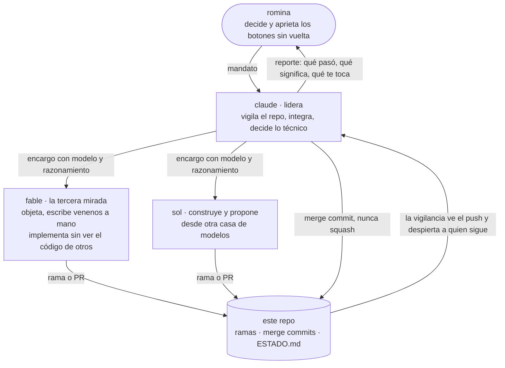

# [nombre del sistema] · frontier bog/26 · reto 2, la caja negra

> **estado: esqueleto antes del brief.** lo marcado `null` se llena cuando el brief diga el contrato. criterio que alimenta esta página: **calidad del repo** (otra persona lo corre copiando estos comandos) y, para el demo, **claridad**.

**una frase:** null. qué hace el servicio original y qué entrega nuestro reemplazo.

## correrlo

```
null   # 1. requisitos: python null, sin dependencias externas para predecir
null   # 2. el entrypoint, exactamente como lo corre el juez
bash smoke.sh   # 3. prueba de humo: responde y la salida tiene la forma del contrato
```

- variables: `OPENROUTER_API_KEY` solo para investigar (el juicio con modelos); **predecir no necesita llave ni red** (`DISENO.md`, D1). null: las de la caja.
- ejemplo de entrada → salida: null (en `evals/ejemplos/`).
- pruebas propias: null.
- **costo por caso medido:** null us$ · null s. con la reserva de us$ 5 caben null casos.

## qué hay adentro

| archivo | qué es | criterio |
|---|---|---|
| `DISENO.md` | diseño, diagrama, decisiones con su alternativa descartada, escalabilidad, cómo absorbe el cambio | systems design |
| `spec.md` | lo que sabemos de la caja: observado / inferido / desconocido, cada cosa con la consulta que la prueba | ejecución |
| `log.jsonl` | cada consulta a la caja, tal cual, append-only | ejecución |
| `incident.md` | el cambio de la tarde: cuándo se notó, qué cambió, qué hicimos, qué no se separó | respuesta al incidente |
| `evals/` | nuestro set: fáciles, difíciles, borde, nuevos y venenos escritos a mano | plan para medir |
| `debrief.md` | cada falla con su causa | lectura de resultados |
| `AGENTS.md`, `ESTADO.md`, `RUBRICA.md` | cómo trabajamos, el estado en vivo y la hoja contra la que se revisa cada entrega | — |

## cómo trabajamos

este repo lo escribieron **una persona y varios modelos que firman lo que escriben**. no es un adorno: es parte de lo que estamos mostrando.



- **cada commit lo firma quien lo pensó** (`git shortlog -sne`): claude, sol, fable o romina. sin coautorías de cortesía.
- **la genealogía queda a la vista:** las ramas de cada pluma entran con merge commit, nunca squash (`git log --graph --oneline`).
- **el desacuerdo entre modelos es señal, el acuerdo es sospecha.** lo aplicamos al equipo y también al sistema: el modelo escéptico vigila cuando los demás coinciden (`DISENO.md`, D4).
- **las reglas salen de errores:** cada *cicatriz* de `AGENTS.md` es algo que nos salió mal en el ensayo del viernes y la regla que dejó.
- **lo que no está escrito no existe:** decisiones, supuestos y fallas van a un archivo con hora y firma (`ESTADO.md`).
- **cualquiera puede decir que no:** un «no pude» o un «no quise, y por esto» vale más que un resultado inventado (`AGENTS.md` § 10).

## lo que no salió

null. lo llenamos durante el día, con su causa. (en el ensayo: todas nuestras fallas fueron mecanismos que el sistema no imaginaba, y todas con confianza máxima. de ahí salió D4.)
