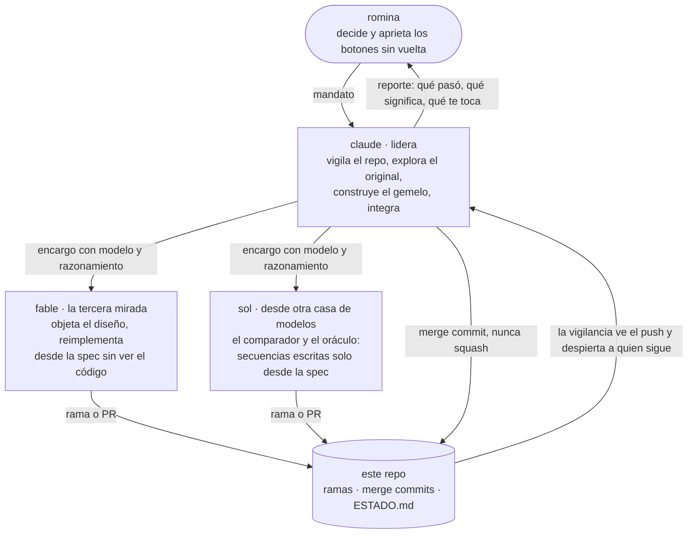

# el gemelo · frontier bog/26 · reto 2, la caja negra

**una frase:** un servicio bancario de mensajes que nadie documentó (`POST /msg` con `{"m": "CMD;arg;…;control"}`), estudiado pedido a pedido hasta poder reemplazarlo por uno nuestro que responde **exactamente igual**, errores y rarezas incluidos, sin llamarlo nunca.

lo que sabemos del original está en [`spec.md`](spec.md), con cada comportamiento citando la línea del log que lo prueba ([`experimentos.jsonl`](experimentos.jsonl)). cómo y por qué lo construimos así, en [`DISENO.md`](DISENO.md). si eres un modelo, empieza por [`llms.txt`](llms.txt); para comprobar cualquier fila de la spec contra el log: `python3 herramientas/verificar_spec.py <ID>`.

## cómo pensamos

tratamos la caja como una pregunta científica y no como una adivinanza. cinco cosas que se pueden revisar en el repo:

1. **medir antes de afirmar.** cada comportamiento de [`spec.md`](spec.md) cita la línea de [`experimentos.jsonl`](experimentos.jsonl) que lo prueba y dice si es *confirmado*, *probable* o *supuesto*. lo que no tiene línea no se afirma.
2. **probar la spec con alguien que no la escribió.** otros modelos leyeron solo la spec y predijeron lo que respondería el original sin verlo: sol acertó 141 de 141 y fable 238 de 238 (`evals/`).
3. **los sesgos de los modelos como instrumento.** pusimos a dos linajes (claude y gpt) a diseñar a ciegas una caja parecida y miramos qué eligió atacar cada uno: uno al programador que corrige, el otro al agente que investiga. con eso apostamos quién pensó la caja real y qué cambiaría en la tarde, y dejamos escritos los límites de la apuesta ([`LINAJES.md`](LINAJES.md)). cuando sol encontró un error en el método del experimento, se escribió y la conclusión se achicó.
4. **preregistrar.** la predicción sobre el incidente de las 15:30, con su criterio de acierto y de fallo, quedó en un commit fechado dos horas antes ([`PREDICCION_INCIDENTE.md`](PREDICCION_INCIDENTE.md)). el resultado se agrega debajo; lo de arriba no se toca.
5. **cambiar el plan con evidencia, a la vista.** el diseño entregado no se edita; cada desvío dice qué planeábamos, qué vimos (con su línea del log) y qué cambiamos ([abajo](#en-qué-nos-desviamos-del-diseño-y-por-qué)).

## correrlo

requisitos: **python 3.9 o más nuevo, nada más** (solo biblioteca estándar; sin llaves, sin red, sin modelos).

```
git clone https://github.com/rominapitronello/frontier-bog26-caja-negra && cd frontier-bog26-caja-negra
GEMELO_TOKEN=un-token PORT=8080 python3 gemelo/servidor.py          # 1. el gemelo, en http://127.0.0.1:8080
bash smoke.sh                                                        # 2. prueba de humo (levanta su propio gemelo)
```

con el gemelo andando (paso 1), en otra terminal:

```
curl -s -H 'Authorization: Bearer un-token' http://127.0.0.1:8080/health
# {"ok":true}
curl -s -X POST -H 'Authorization: Bearer un-token' -d '{"m":"ALTA;Lucia;82"}' http://127.0.0.1:8080/msg
# {"cuentaId":"AC-0001"}
curl -s -X POST -H 'Authorization: Bearer un-token' -d '{"m":"ALTA;Lucia;83"}' http://127.0.0.1:8080/msg
# {"error":"E202","mensaje":"control inválido"}
python3 herramientas/control.py 'DEPOSITO;AC-0001;5000'           # el dígito de control de un mensaje → 63
python3 medir.py --casos material/pruebas/ejemplos.jsonl --gemelo http://127.0.0.1:8080 --token un-token
# Secuencias que pasan: 1/1
```

- **el contrato del reto:** `Authorization: Bearer <token del equipo>` en todo; `GET /health` → 200 cuando está listo; `POST /__reset` vuelve al estado inicial; cualquier otra ruta responde lo mismo que el original, incluidas las que no existen. el token se configura con `GEMELO_TOKEN`; sin él, el gemelo no arranca (falla ruidoso, no responde 401 a todo en silencio).
- **despliegue:** `Dockerfile` en railway, con la configuración en el panel (una réplica, sin dormir, healthcheck en `/health`): `railway.json` queda como registro de lo que pedimos, pero railway no lo lee (desvío abajo). el set del jurado le habla a un solo proceso: el estado vive en memoria.
- **pruebas:** `bash smoke.sh` pasa al gemelo los 20 ejemplos del material y **todas las secuencias del log** con la regla de comparación del juez (status + cuerpo; json sin orden de claves). `python3 pruebas/test_medir.py` prueba el comparador.
- **costo por caso:** 0 us$ y menos de un milisegundo: el gemelo no llama a nadie ni usa modelos (`DISENO.md`, D6).

## resultados

| cuándo | set oculto del jurado (100 tests) | nota |
|---|---|---|
| 10 oct 11:06 bog · validación 1 de 3 (contra v1) | **83/100** | línea base. desglose que la plataforma mostró después: **fáciles 40/40, regulares 33/40, difíciles 10/20** (el set es 40/40/20, no 40/45/15 como dice el material); 10 por status y 7 por cuerpo; 3 en el primer pedido y 14 más adelante. la entrada estaba bien: los 17 son deriva de estado en secuencias. un redespliegue nuestro cayó a mitad de la corrida (`ESTADO.md`) |

nuestras propias mediciones, sin gastar validaciones: el gemelo reproduce los 20 ejemplos y todas las secuencias del log (`bash smoke.sh`), y las 40 secuencias que sol escribió solo desde la spec (`evals/sol-03.jsonl`: 141 de 141).

## qué hay adentro

| archivo | qué es | criterio |
|---|---|---|
| `gemelo/servidor.py` | el reemplazo: la cadena de errores en el orden observado y el estado (cuentas, operaciones, bloqueos, `HALT`) | ejecución |
| `gemelo/modelo.json` | lo aprendido como **dato**: errores, aridades, límites, el control, `HALT`. cada valor cita el log. si el servicio cambia un texto o un límite, se cambia aquí | ejecución · cambio |
| `spec.md` | el servicio para reimplementarlo sin tocarlo: 7 secciones, cada fila con evidencia y confianza (confirmado / probable / supuesto) | ejecución |
| `experimentos.jsonl` | **cada pedido que le mandamos al original**, con su hipótesis; `experimentos_crudo.jsonl` guarda los headers (el token tapado) | ejecución |
| `DISENO.md` | diseño de una página, diagrama, decisiones con su alternativa descartada, escalabilidad y cambio | systems design |
| `herramientas/` | `lote.py` y `sonda.py` (mandan y anotan pedidos), `control.py` (el dígito de control), `centinela.py` (repite una secuencia canónica y avisa si el original cambia o el gemelo difiere), `vigilancia.sh` (avisa cada push) | método |
| `medir.py` | el comparador con la regla del juez (lo escribió sol) | plan para medir |
| `encargos/` | lo que se le pidió a cada modelo y lo que respondió | cómo trabajamos |
| `incident.md`, `debrief.md`, `evals/` | el incidente de la tarde, el debrief y el set retenido (se llenan durante el día) | incidente · resultados |
| `AGENTS.md`, `ESTADO.md`, `RUBRICA.md` | cómo trabajamos, el estado en vivo y la hoja contra la que se revisa cada entrega | — |

## qué encontramos (lo grueso; el detalle con evidencia está en la spec)

- **el dígito de control es el del iban** (iso 7064 mod 97-10): las letras valen su posición en el alfabeto, los dígitos lo que son, y control = 98 − (100·N mod 97). salió de mirar los ejemplos, sin gastar pedidos, y lo encontraron por separado claude y fable.
- **ocho comandos**, dos ocultos: `HALT;1` detiene el servicio para el token (503) hasta el reset, y `NOTAS` devuelve una nota interna. aparecieron porque el error de comando desconocido **sugiere** el comando más parecido (`HELP` → `HALT`, `TOTAL` → `NOTAS`).
- **reglas con estado que los ejemplos no muestran:** el límite de 100.000 no aplica entre cuentas del mismo titular (por nombre); tres transferencias rechazadas seguidas bloquean la cuenta (`E510`) hasta un depósito; anular puede dejar saldos negativos.
- **el orden exacto de 20 códigos de error**, de la ruta al saldo, con un pedido que rompe dos cosas a la vez para cada par.

## en qué nos desviamos del diseño y por qué

el diseño se entregó a las 12:00 (`DISENO.md`, commit `3357774`) y no se toca. regla de romina: si la evidencia muestra que una parte del plan falla, nos desviamos sin pedir permiso y lo escribimos (`ESTADO.md`, «desvíos del diseño»). hasta ahora:

- **el centinela empezó a las 10:4x, no a las 15:00.** en su primera vuelta encontró que nuestra propia spec decía mal el orden entre el límite y el saldo (log 737). sin él lo habríamos entregado así.
- **la versión de la mañana se congela como archivo, no como tag:** el entorno no deja subir tags.
- **sumamos un fuzzer diferencial**, que el diseño había descartado: con 83/100 en el set y 141/141 en nuestras propias secuencias, lo que fallaba estaba fuera de lo que sabíamos preguntar. no encontró diferencias en lo conocido (1281–1613), y eso también es un resultado.
- **la spec se prueba con predicciones ciegas y no con un segundo gemelo:** otro modelo lee solo la spec y predice qué responde el original. sol acertó 141 de 141 y fable 238 de 238.
- **el gemelo cuenta la forma del tráfico del set, sin su contenido.** el diseño decía que no registraría nada del set (D10). después del incidente, el original no le mostró la versión 2 a nuestro token (533 pedidos repetidos exactos, 0 diferencias), y el set pasó a ser la única ventana hacia v2. romina decidió una telemetría mínima: cuántos pedidos caen en cada rama (comando y código), cuántos en lo que la spec marca «supuesto», el largo de las secuencias y la concurrencia. ni un texto, nombre, monto ni id.
- **railway no lee `railway.json`.** el diseño cerraba ahí una réplica, sin dormir y el reinicio; el panel mostró a las 15:3x que el archivo no se aplica (config as code está deprecado) y que no había healthcheck: un despliegue roto habría reemplazado al que funcionaba. la configuración pasó al panel, y el gemelo responde 200 en `/health` solo al healthcheck de railway, que el juez nunca usa; con eso, el healthcheck quedó puesto y pasa (15:34 bog).

## cómo trabajamos

este repo lo escribieron **una persona y varios modelos que firman lo que escriben**. no es un adorno: es parte de lo que estamos mostrando.



- **cada commit lo firma quien lo pensó** (`git shortlog -sne`): claude, sol, fable o romina. sin coautorías de cortesía.
- **la genealogía queda a la vista:** las ramas de cada pluma entran con merge commit, nunca squash (`git log --graph --oneline`).
- **coincidir no es observar:** que claude y fable llegaran a la misma fórmula del control no la confirmó; la confirmaron pedidos nuevos al original. y la spec la ponen a prueba secuencias que escribe otra casa de modelos sin ver nuestro código (`encargos/sol-03-oraculo.md`).
- **las reglas salen de errores:** cada *cicatriz* de `AGENTS.md` es algo que nos salió mal y la regla que dejó.
- **lo que no está escrito no existe:** decisiones, supuestos y fallas van a un archivo con hora y firma (`ESTADO.md`).
- **cualquiera puede decir que no:** un «no pude» o un «no quise, y por esto» vale más que un resultado inventado (`AGENTS.md` § 10).

## lo que no salió

- **un bucle nuestro gastó ~400 pedidos.** una búsqueda binaria del tope del cuerpo no podía armar cuerpos de 8.192 y 8.193 bytes, volvía atrás y repetía el mismo pedido; romina la cortó. quedan en el log (líneas 289–686, marcadas) porque se mandaron. desde entonces `lote.py` se detiene si un pedido se repite más de 5 veces seguidas.
- **la v1 de la spec decía mal el orden entre límite y saldo.** lo leímos de un solo pedido (111) que, sin saberlo, era entre dos cuentas del mismo titular. lo vio el centinela en su primera vuelta; una repetición exacta descartó que el original hubiera cambiado y separó la causa (el titular). la spec lo cuenta en CA-03.
- **la primera fórmula del control tenía mal el rango** (0–96 en vez de 2–98): la separaron dos pedidos elegidos para eso (24–27).
- **los tags verdes no suben desde la sesión que lidera:** el proxy de git de su entorno rechaza el push de tags (403). `verde-01` existe en local; queda anotado en `ESTADO.md`.
